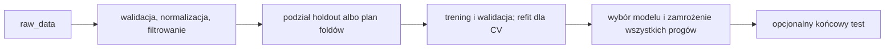

# Sprint 3 — eksperymenty lokalne (#18)

Owner: Arrow; review: Anton. Domyślny tryb obejmuje trening i lokalne raporty bez kont
i sieci. Opcjonalny tracking i komendy publikacji: [sprint-3-wandb.md](sprint-3-wandb.md).
Domyślny `kedro run` nadal odtwarza baseline S2 (80/20); eksperymenty są osobnymi pipeline’ami.

## Trzy aktywne protokoły

Wspólny test to końcowe 20%: 9043 rekordy. `project.yaml` jest źródłem cech, seeda
i proporcji splitu. Zachowujemy kolejność i indeks; nie sortujemy po indeksie.
70/15/15 wycofano z aktywnego porównania. Archiwalne wyniki lokalne pozostają na dysku.

| Pipeline | Wybór konfiguracji i progu | Model końcowy |
| --- | --- | --- |
| `experiments` | holdout: 28 934 train / 7234 validation | dopasowany na 64% |
| `experiments_bagged` | 5 losowych foldów stratyfikowanych w pierwszych 80%, pooled OOF F1 | bagging; baseline refit na 80% |
| `experiments_crossfold` | 3 rozszerzające się okna, średnie F1 okien | refit na 80% |

Crossfold ma nominalne granice: train 0–32% → validation 32–48%, train 0–48% →
validation 48–64%, train 0–64% → validation 64–80%. Prawy kraniec jest wyłączny.
Preprocessing dopasowuje się tylko na train foldu. W AutoGluonie jawnie prefituje się
generator cech, aby domyślnie nie analizował także `tuning_data`.
Po walidacji ostatni wybrany model i jego zależności są refitowane na całym development.

Bagging miesza okresy wewnątrz pierwszych 80%. AutoGluon współdzieli generator cech
wewnątrz development; RF/XT mogą używać natywnego OOB. Ten OOF nie jest oceną
prognozowania przyszłego okresu. Nie porównujemy go wprost ze score’em chronologicznych okien.

## Jawne etapy pipeline’u



Etapy są osobnymi nodami Kedro. Dopiero `freeze_validation_decision` tworzy
`selection.json` z modelem, ścieżkami i progami **wszystkich** kandydatów.
`evaluate_frozen_test` korzysta z tego snapshotu, a nie z mutowalnego raportu treningu.
Ostatni node `track_experiment` publikuje gotowe wyniki tylko w trybie online/offline;
przy `disabled` pomija SDK. Końcowym wyjściem runnera jest `experiment_tracking`,
a decyzja i test pozostają zapisane jako pliki JSON.
Niezgodne dane, konfiguracja lub zmieniony snapshot blokują test. Ponowna selekcja
lub nadpisanie raportu testowego tego samego runu są odrzucane.
Przed podziałem testowym i ładowaniem modelu wspólny `assert_prepared_data` sprawdza,
czy `prepared_data` odpowiada normalizacji i filtrowaniu `raw_data`: porównuje target,
cechy wymagane kontraktem, typy, indeks i kolejność. Poprawne usunięcie rekordów bez
targetu oraz pominięcie cech wykluczonych (np. `duration`) są dozwolone.

Próg maksymalizuje F1 na validation albo predykcjach OOF/forward; przy remisie wybieramy
wyższy próg. Crossfold stosuje jeden próg do wszystkich okien i raportuje ich średnią,
minimum i odchylenie F1. Remis między konfiguracjami rozstrzyga nazwa alfabetyczna.
Dummy w holdout ma stały próg 0,5. Raporty zachowują również wynik każdego modelu przy 0,5.
Te same dane służą do selekcji i oceny validation, więc ten wynik jest optymistyczny;
końcowy test nie uczestniczy w dopasowaniu ani doborze progu.

## Konfiguracja i uruchomienie

```bash
conda activate asi-ml
python -m pip install -r requirements/preflight-s3.txt -c constraints.txt
python -m pip check

# Każdy protokół: trening, zamrożenie decyzji, końcowy test.
KEDRO_DISABLE_TELEMETRY=1 kedro run --pipelines experiments_test
KEDRO_DISABLE_TELEMETRY=1 kedro run --pipelines experiments_bagged_test
KEDRO_DISABLE_TELEMETRY=1 kedro run --pipelines experiments_crossfold_test
```

Bez `_test` przebieg kończy się zapisaniem decyzji po walidacji. `--env ci` wybiera
próbkę i sam baseline, bez SDK AutoGluona/W&B. Aby sprawdzić AutoGluona na próbce,
dodać `--env ci --params experiments.autogluon_enabled=true`.
Na PowerShell ustawić `$env:KEDRO_DISABLE_TELEMETRY="1"` przed `kedro run ...`.

`conf/base/parameters_experiments.yml` definiuje cztery konfiguracje: dwa LightGBM,
CatBoost i zestaw GBM/CAT/RF/XT. Każdy `fit` ma budżet 120 s, 8 CPU i 0 GPU.
Log-loss służy do early stopping i wewnętrznej selekcji AutoGluona; projekt wybiera
według F1. Nie używamy stackingu ani dynamic stacking. Crossfold może wykorzystać
trzy budżety na konfigurację; `refit_full` jest poza limitem `fit` i odtwarza wybraną
liczbę iteracji. To nie jest twardy limit czasu całego procesu.
Liczby foldów są w `parameters_validation_protocols.yml`.

## Pliki wynikowe i przekazanie do #19/#20

Catalog wskazuje `experiment_store`: `data/08_reporting/experiments/` dla pełnych danych,
`data/08_reporting/ci/experiments/` dla próbki. Każdy run ma osobny katalog UTC/protokół/ID.

| Plik | Kontrakt |
| --- | --- |
| `config.json`, `provenance.json` | efektywne parametry, SHA, dirty flag, fingerprint i wersje |
| `split.json` albo `folds.json` | dokładne granice pozycyjne i plan foldów |
| `metrics.json` | status treningu, wyniki validation, progi, ścieżki i `model_kind` |
| `<model>_oof.json` | indeksy, etykiety i prawdopodobieństwa użyte przez CV |
| `selection.json` | niezmienny snapshot wszystkich progów i wybór przed testem |
| `test_metrics.json` | osobny status i metryki finalnego testu, tylko dla `_test` |

Fingerprint `loaded-data-csv-v1` to SHA-256 CSV wczytanego `raw_data`, z nagłówkami,
indeksem, kolejnością i końcami linii LF. To inny hash niż bajty oryginalnego pliku
z downloadera. Dirty flag oznacza, że sam SHA nie odtwarza niezacommitowanego kodu.
Raporty JSON są zapisywane atomowo. Błąd zachowuje wcześniejsze wyniki i status `failed`.

Modele są natywnymi wynikami eksperymentów: pickle sklearn albo katalog AutoGluona.
`models.py` obsługuje ten lokalny zapis/odczyt; to nie jest pakiet produkcyjny z #20.
Anton otrzymuje model, config, provenance, metryki i próg z `selection.json`.
Przy predykcji trzeba użyć `P(y=1) >= decision_threshold`; natywne `predict()` może
nadal używać 0,5. Docelowy pakiet, wspólny loader i alias `production` należą do #20.
Pojedynczy `prediction_seconds` w holdout jest pomiarem pomocniczym, nie benchmarkiem #19.

## Zapisane wyniki porównania

F1 na tych samych końcowych 9043 rekordach, z progami dobranymi bez testu:

| Model | 64/16/20 | 80/20 bagged | Crossfold chronologiczny |
| --- | ---: | ---: | ---: |
| baseline | 0,5064 | 0,4892 | 0,5210 |
| gbm_small | 0,5390 | 0,4209 | 0,4923 |
| gbm_large | 0,5220 | 0,3617 | 0,4817 |
| catboost | 0,1510 | 0,5103 | 0,4800 |
| tree_ensemble | 0,1737 | 0,4976 | 0,4800 |

Przed testem: holdout i bagging wybrały `tree_ensemble`, crossfold wybrał baseline.
Źródła lokalne: `20261123T225040-363c1efb`, `20261123T230646-bagged-18271cdb`,
`20261123T230547-chronological-1ba8a098`. Pełne modele pozostają poza Gitem;
tabela jest dostępna również po czystym sklonowaniu repozytorium.
Test był już oglądany w eksploracjach: jest wspólnym benchmarkiem, nie nowym niezależnym
audytem. Produkcyjna decyzja pozostaje w #19 i obejmuje również koszty użycia.

Początkowe F1=0 przy progu 0,5 było poprawnie policzone: train miał 5,0% pozytywów,
validation 13,7%. Dobór progu i log-loss pozwoliły rozdzielić sygnał modelu od decyzji
klasyfikacyjnej; nie usuwają dryfu między okresami.

## Sprawdzenia

Aktualny stan z trackingiem: **380 testów przeszło w czystym checkoutcie `b6ecf55`**,
bez lokalnych ustawień; przeszły również pre-commit i kontrola diffu. Testy Git zachowują
izolację od lokalnego podpisywania i hooków. Po review ponowiono trzy pełne przebiegi
AutoGluona: wyniki F1 i wybory modeli pozostały zgodne z tabelą. Identyfikatory runów:
`20261123T232543-holdout-6bf251c7`, `20261123T232543-bagged-c7e1b345`,
`20261123T232543-chronological-3d2c20c4`.
Świeży holdout z W&B: `20261124T161322-holdout-b410b77e`; F1 pozostały zgodne z tabelą.
Pierwszy run W&B odtworzył baseline S2 przy progu 0,5. Linki i potwierdzenie 17 runów
są w [notatce W&B](sprint-3-wandb.md).

Graf i wejścia nodów: [`pipeline.py`](../../src/asi_project/pipelines/experiments/pipeline.py).
Podział odpowiedzialności: `splits.py` — granice/foldy, `models.py` — adaptery,
`nodes.py`/`cross_validation.py` — trening, `scoring.py` — metryki i progi,
`evaluation.py` — zamrożenie decyzji i test, `artifacts.py` — raporty lokalne.

```bash
pytest -q
pre-commit run --all-files
```

Testy obejmują granice i kierunek foldów, rzeczywisty runner Kedro dla sześciu wariantów,
zapis/odczyt i osobny proces bez `fit`, wyrównanie klas/indeksów prawdopodobieństw,
niezmienność wszystkich progów, odrzucenie niezgodnych danych, błędy zapisu i wyniki
częściowe. Testy kontraktu SDK nie zastępują rzeczywistych przebiegów AutoGluona;
te sprawdzamy komendami powyżej na próbce i pełnych danych.
Regresje po review obejmują zmianę samego `prepared_data` bez zmiany fingerprintu raw
oraz izolację fixture Git od podpisywania, hooków i przekierowań środowiskowych.
